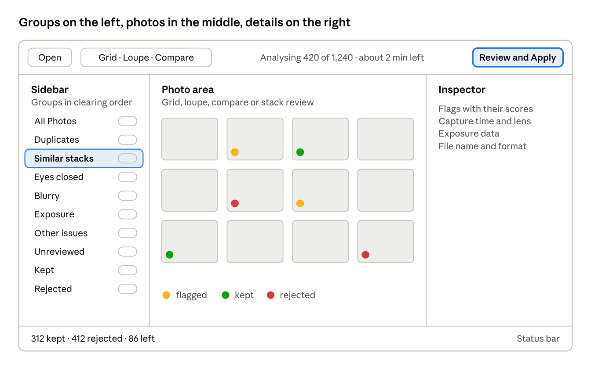
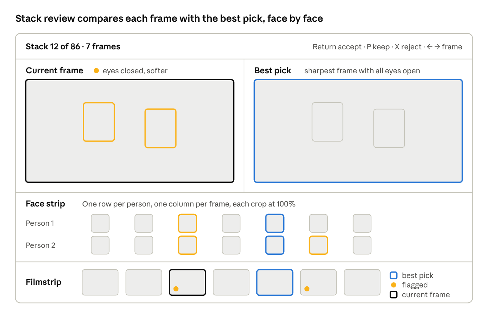

# Culla — Design

Last updated: 2026-11-24

Culla sorts a shoot into groups of likely rejects and lookalikes, then lets one person clear the batch from the keyboard without deleting anything by accident. This doc defines the screens, the decision model, the key map and the settings. The step-by-step journeys are in [User Flows](user-flows.md); the build order is in the [Implementation Plan](implementation-plan.md).

## Principles

1. **Nothing is deleted until you say so.** Decisions are marks. Files move only on Apply, and Apply can be undone.
2. **Keyboard first.** Every culling action is one key. The mouse is never required.
3. **Culla suggests, you decide.** Detection pre-selects and explains. Bulk rejection exists only for the Certain tier, and only on request.
4. **Always say why.** Every flag shows its reason and its evidence: the closed eye, the soft region, the matching copy.
5. **Never wait.** The grid works while analysis runs, and moving a slider regroups the batch instantly.

## Main window

The top bar and status bar stay fixed. The photo area changes with the group selected in the sidebar, and the inspector can be hidden with I.

The top bar is flat and drawn by Culla itself; it does not use the system toolbar's glass capsules. From the left: the shoot's name and photo count, Open, the view switch (grid, loupe, compare), the analysis status in the middle, the thumbnail-size slider, Review and Apply, and the inspector switch. Icon buttons have no background until the pointer is over them, the view switch is a flat pill, the status is plain text, and Review and Apply is the one filled button, in the same neutral fill as the view switch's selected pill (light grey with white text in dark appearance) so it does not tint how photos are judged. When the window is narrow the bar gives way in a fixed order: the status moves off centre, the photo count goes, the title shortens, the status text shortens and then becomes its icon alone. The buttons, the switch and the slider are never cut.

## Sidebar groups

The sidebar lists groups in the order Culla recommends clearing them, each with a "left to review / total" count. A photo can sit in several groups; one decision clears it from all of them.

| Group | A photo lands here when | Opens in |
| --- | --- | --- |
| Duplicates | Its file content is identical to another, or the image is near-identical | Duplicate sets, side by side |
| Similar stacks | Two or more photos were taken close together and look alike | Stack review |
| Eyes closed | A main-subject face has closed eyes | Loupe, zoomed to the face |
| Blurry | The subject is soft or motion-blurred | Loupe, zoomed to the subject |
| Exposure | Highlights or shadows are heavily clipped | Loupe with clipping overlay |
| Other issues | Tilted horizon, a face cut by the frame edge, lens smudge, or an accidental shot | Loupe |
| Unreviewed | It has no decision yet | Loupe with filmstrip |
| Kept | You kept it | Grid |
| Rejected | You rejected it | Grid |

All Photos sits above the list and shows the whole shoot in capture order. Duplicates come first because they are the fastest to clear; stacks come second because they remove the most photos per keystroke.

## Views

Four views share one selection, so switching view never loses your place.

- **Grid.** Thumbnails in capture order with a size slider. Each tile shows reason badges, a decision tint (green tick for kept, dimmed with a red cross for rejected) and a star on a stack's best pick. In All Photos a stack collapses to one tile with a count.
- **Loupe.** One photo fitted to the window with a filmstrip below. Face boxes are outlined by eye state. Z zooms to 100% on the most relevant spot: the flagged face if there is one, otherwise the sharpest part of the subject. Tab moves between faces while zoomed.
- **Compare.** Two to four photos side by side with linked zoom and pan. Keep and reject apply to the focused pane.
- **Face strip.** A row per person and a column per frame, each cell a 100% crop of that face. Closed eyes are outlined. It appears under stack review and under any group photo in the loupe.

The inspector on the right shows the selected photo's flags with their scores, capture time, lens and exposure data, and the file's name and format.

## Stack review

Stack review is where most culling happens: one burst at a time, with Culla's best pick pinned beside the frame you are judging.

The arrow keys move the current frame along the filmstrip while the best pick stays on the right. Amber outlines mark closed eyes, so a bad frame shows up as an amber column in the face strip. Return keeps the pick, or the frames you marked with P, and rejects the rest.

Two keys trade context for size:

- **H** hides the best pick pane, and the current frame fills the row. The hint line at the top of stack review ends with "H hide pick" or "H show pick". Nothing else changes: the pick is still starred in the filmstrip, the current frame's caption still says how it compares with the pick, and Return still keeps the pick or the frames you marked. The choice is a preference for every shoot, also in Settings ▸ General, and is remembered.
- **F** hides the faces: the face strip and the boxes drawn over faces on both frames go together, and the frames take the strip's height. The hint line says "F hide faces" or "F show faces". While faces are hidden, B does nothing, since there are no boxes to switch. A stack with no faces shows no strip at all.

## Decision model

A photo carries three independent things: a decision you make, flags Culla raises, and an optional star rating.

| Thing | Values | Who sets it | Shown as |
| --- | --- | --- | --- |
| Decision | Unreviewed, Kept, Rejected | You | Tile tint and tick or cross |
| Flag | Eyes closed, Blurry, Duplicate, Exposure, Other | Culla | Reason badge on the tile |
| Flag tier | Certain, Likely | Culla, from your thresholds | Solid badge for Certain, outlined for Likely |
| Best pick | One frame per stack | Culla, until you override | Star on the tile |
| Rating | 0 to 5 stars | You | Stars under the tile |

Three rules keep this predictable:

- A flag never changes a decision. Flagged photos stay Unreviewed until you act. A bulk reject is also an action you start, never something Culla does alone.
- Changing a threshold moves undecided photos between groups but never touches a decision already made.
- Unreviewed photos count as kept when you apply, so you only ever have to find the rejects.

## Keyboard

Keep, reject and clear follow the P / X / U habit from Lightroom. Every key can be remapped in Settings.

| Key | Action | Where |
| --- | --- | --- |
| P | Keep, then advance | Everywhere |
| X | Reject, then advance | Everywhere |
| U | Clear the decision | Everywhere |
| ← → | Previous or next photo | Everywhere |
| ↑ ↓ | Previous or next row; previous or next stack | Grid; stack review |
| Return | Accept: keep the picks, reject the rest, open the next stack or set | Stack review, Duplicates |
| ⇧X | Reject all remaining Certain photos in this group | Defect groups |
| Space | Switch between grid and loupe | Everywhere |
| Z | Zoom to 100% on the face or subject, and back | Loupe, stack review, compare |
| Tab | Next face while zoomed | Loupe, stack review |
| C | Compare the selected photos | Grid, stack review |
| F | Show or hide the face strip; in stack review, the face boxes with it | Loupe, stack review |
| H | Show or hide the best pick beside the current frame | Stack review |
| G / ⇧G | Add the selection to a stack / split a frame out of its stack | Grid, stack review |
| ⇧S | Make the current frame the best pick, or return to Culla's pick | Stack review |
| S | Expand or collapse all stacks | Grid |
| ⇧Return | Accept all exact duplicate sets | Duplicates |
| B / J | Show or hide face boxes / the clipping overlay | Loupe, stack review |
| ⇧⌘R | Start reviewing: open the first group with photos left | Everywhere |
| ⌥⌘P / ⌥⌘T | Pause or resume analysis / adjust detection for the open group | Everywhere |
| Esc | Back to where you came from | Loupe, compare, stack review |
| 1 to 5, 0 | Set or clear the star rating | Everywhere |
| ⌘] / ⌘[ | Next or previous sidebar group | Everywhere |
| I | Show or hide the inspector | Everywhere |
| ⌘Z / ⇧⌘Z | Undo or redo any decision, including bulk ones | Everywhere |
| ⌘Return | Open Review and Apply | Everywhere |
| ⌘O / ⌘, | Open a folder / open Settings | Everywhere |

Keys work by their position on the keyboard when the active layout does not type Latin letters. With a Russian layout the P key types «з» and still keeps a photo; with a Turkmen layout the X key still rejects.

## Review and apply

No file moves until this screen is confirmed. It is the single place where decisions become changes on disk.

- **Summary line.** Counts of kept, rejected and unreviewed photos, and the disk space the rejects occupy.
- **Rejects, grouped by reason.** Thumbnails under headings such as Eyes Closed and Duplicates. Press P on any tile to rescue it.
- **What happens to rejects.** One of three actions, preset from Settings:
  - Move to a `_Rejected` folder inside the shoot (default).
  - Mark only: write the reject flag to an XMP sidecar and leave the file in place.
  - Move to the Trash.
- **Sidecars.** Decisions and star ratings are written as `<name>.xmp` beside each photo; Culla never modifies an image file. Stars go to the XMP rating. A rejected photo gets rating -1 and the label "Red"; a kept one the label "Green". An unreviewed, unrated photo gets no sidecar. An existing sidecar is merged, keeping everything else in it.
- **What editors read.** Lightroom Classic and Capture One read sidecars for RAW files. For JPEG and HEIC they read only metadata embedded in the file, so for those photos the hand-off is the `_Rejected` folder, not the sidecar. Culla does not embed ratings into JPEG or HEIC files, because that would change the originals (confirmed 2026-11-10). The editor Culla is first checked against is Photomator; what it reads from these sidecars is not yet confirmed in the application.
- **After applying.** A banner confirms the result and offers Undo, Reveal Keepers in Finder, and Open Keepers In an external editor.

Culla never empties the `_Rejected` folder or the Trash itself.

## Languages

Culla is in English, Russian and Turkmen. It follows the language order in System Settings and uses English when none of its languages is there. Settings ▸ General has a language choice, because macOS itself is not translated into Turkmen and a Turkmen speaker's system is usually in another language. A change takes effect when Culla is next opened, and Settings offers to quit and reopen it. Language names are always shown in their own language.

The `_Rejected` folder name and everything written to sidecars are the same in every language. Glossary and style rules are in `docs/localization.md`.

## Settings

Three presets (Lenient, Balanced, Strict) set every detection slider at once; Balanced is the default. The eye, blur, similarity and aesthetics defaults were chosen by eye from the contact sheets of a first real shoot on 2026-11-09. The exposure defaults are provisional: that shoot showed the first proposals were far too low, and no photo in it should be flagged. Other values are still proposals.

| Pane | Setting | Options | Proposed default |
| --- | --- | --- | --- |
| General | Language | System default, English, Русский, Türkmençe | System default |
| General | Reject action | `_Rejected` folder, mark only, Trash | `_Rejected` folder |
| General | Write XMP sidecars | On, off | On |
| General | Advance after a decision | On, off | On |
| General | Show best pick beside the current frame | On, off | On |
| General | Include subfolders | On, off | On |
| General | Check for updates automatically | On, off | On |
| Eyes | Sensitivity | 0 to 100 | 50, which flags eye openness below 0.26 |
| Eyes | Smallest face to check | 1 to 20% of the frame's short side | 4% |
| Eyes | Ignore background faces | Off, or faces under 20 to 80% of the largest face | Under 40% |
| Eyes | Group photo rule | Any main face, most faces, all faces | Any main face |
| Eyes | Count a wink as closed | On, off | Off |
| Eyes | Skip profiles and sunglasses | On, off | On |
| Blur | Sensitivity | 0 to 100 | 50, which flags sharpness below 25 |
| Blur | Measure sharpness on | Subject only, whole frame | Subject only |
| Blur | Faces take priority over other subjects | On, off | On |
| Similarity | Time gap that splits a stack | 1 to 60 s | 10 s |
| Similarity | Visual similarity | 0 to 100 | 50, which joins frames up to a feature distance of 0.60 |
| Similarity | Smallest stack | 2 to 5 photos | 2 |
| Similarity | Use the camera's burst data | On, off | On |
| Duplicates | Exact copies | On, off | On |
| Duplicates | Near-duplicates | On, off | On |
| Duplicates | Treat RAW+JPEG as one photo | On, off | On |
| Exposure | Flag clipped highlights above | 5 to 90% of the frame | 30% |
| Exposure | Flag clipped shadows above | 5 to 90% of the frame | 50% |
| Other | Tilted horizon, cut-off faces, lens smudge, accidental shots | Each on or off | All on except horizon |
| Other | Flag an aesthetics score below | -1 to 1 | 0.30 |
| Performance | Analysis speed | Full, reduced on battery | Reduced on battery |
| Performance | Cache size limit | 1 to 50 GB | 5 GB |
| Keys | Remap any shortcut | — | The key map above |

Every detection slider shows a live count of the photos it would flag in the open shoot.

## Feedback and states

The app always shows what it is doing and how much culling is left.

- **Analysis progress.** A toolbar indicator reads, for example, "Analysing 420 of 1,240 · about 2 min left". Sidebar counts update as results arrive.
- **Culling progress.** The status bar shows kept, rejected and left to review, for example "312 kept · 412 rejected · 86 left".
- **Empty groups.** A group with nothing in it says so in one line, such as "No closed eyes found", and offers the next group.
- **Unreadable files.** The tile shows a warning icon, the file is left out of every group, and the status bar counts such files.
- **Missing volume.** If a card or drive disconnects, tiles dim, analysis pauses and decisions are kept until it returns. A photo whose image could not be loaded meanwhile shows a placeholder and loads when the volume is back; it is not reported as unreadable.
- **Decisions not saved.** If the database cannot be written, the status bar shows a warning rather than failing silently.
- **First run.** The welcome view carries a short introduction with the five keys that matter (keep, reject, clear, grid/loupe, accept), read from the live key map. It goes away with Got It or on opening a first shoot. Help ▸ Keyboard Shortcuts (⌘/) shows the whole key map at any time.
- **A newer version.** At most once a day Culla asks `cullaapp.com` which version is the newest. If there is a newer one, the welcome view shows one line, for example "Culla 1.1 is available.", with Download, Release Notes and Skip This Version. Nothing appears over an open shoot and no dialog opens on its own. Culla ▸ Check for Updates… asks at once and always answers: this is the newest version, a newer one is available, the newer one needs a newer macOS, or the check could not be made. Download opens the site in the browser; Culla does not install anything itself. Settings ▸ General has the switch, a Check Now button and the time of the last check.
- **Rescanning settings.** Turning "Include subfolders" off or "Treat RAW+JPEG as one photo" on while a shoot is open asks first when photos would leave the session, saying how many and how many decisions would be lost.

Look and accessibility:

- The interface is neutral dark grey by default so it does not tint how photos are judged, with an option to follow the system appearance.
- Colour only ever carries meaning: green for kept, red for rejected, amber for flagged. Each is paired with an icon, so nothing depends on colour alone.
- Every control has a VoiceOver label, and Reduce Motion and larger text sizes are respected.

## Confirmed decisions

These were open questions; all were confirmed in review on 2026-11-09.

- Keep, reject and clear are on P / X / U, matching Lightroom.
- The default reject action is the `_Rejected` folder.
- Stacks collapse to one tile in All Photos.
- The inspector is hidden by default and opened with I.
- The interface is dark by default.
- Star ratings are in the first version.
