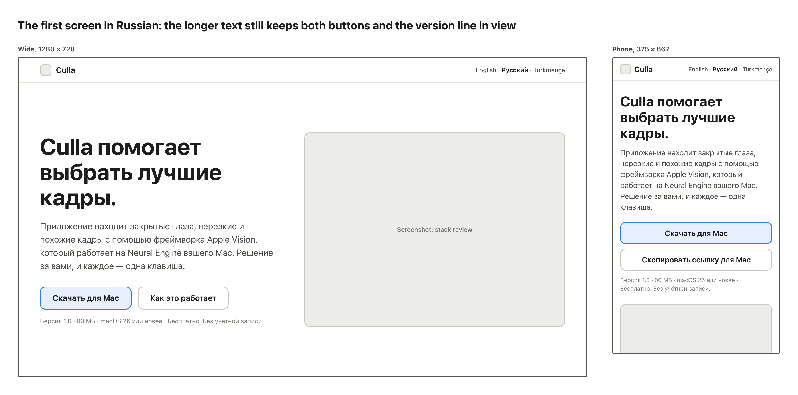

# Culla — Landing Page Plan

Last updated: 2026-11-20

A plan for the public website of Culla, `https://cullaapp.com`. The site is in `site/`; its README says how to build and deploy it. The page has one job: a photographer who lands on it understands in five seconds that Culla is free and open source, that it runs on their Mac's own hardware, and that culling happens from the keyboard, and can download it without scrolling.

## Decisions

| Question | Decision | Why |
| --- | --- | --- |
| Framework | Nuxt 4, generated as a static site (`nuxt generate`) | The page has no per-visitor content; static files are the simplest thing for nginx to serve |
| Backend | None. No Go service in the first version | Nothing on the page needs a program running on the server (see [Backend](#backend)) |
| Address | `https://cullaapp.com` | Decided by the owner |
| Server | The owner's Linux server, with nginx serving the generated files from `/data/cullaapp.com/www/` | Decided by the owner |
| Where the code lives | `site/` in this repository | The site reuses the app's screenshots, glossary and release script |
| Downloads | The notarized disk image is an asset of a GitHub Release in `kpirliyev/culla`. `https://cullaapp.com/download` stays as a short link that redirects to it | Culla is open source and published on GitHub (decided by the owner on 2026-11-20), so the release lives where the code does and the server holds no large file |
| Source code | Open source under the MIT licence at `https://github.com/kpirliyev/culla`. The page says so on the first screen, in the proof strip, in the maker's note, in the questions and in the footer | Decided by the owner on 2026-11-20. It is the strongest answer to "what's the catch?": anyone can read what the app does |
| Languages | English, Russian, Turkmen, as in the app. English is the default: it is shown whenever the browser asks for none of the three | Same audience; reuse `docs/localization.md` for terms |
| Contact | GitHub: an issue form for bugs, an issue form for feature requests, and Discussions for questions. No form on the page, and no email address on the page or in this repository | Decided by the owner on 2026-11-20. Bugs and ideas are public and searchable, the maker's address stays private, and the server has nothing to receive or send |
| Counting | Visits are counted from the nginx log, with shortened IP addresses. Downloads of each version are read once a day from GitHub's own count for each release asset. Both go into CSV files. A report page (GoAccess) is left for later | The owner needs both numbers; neither needs a script or cookie on the page |
| Tracking | None. No cookies, no analytics script, no third-party fonts or scripts, and the page loads nothing from GitHub; it only links there. The page says plainly what the server log keeps and that the download comes from GitHub | The app has no network access; the site makes the same promise and needs no consent banner |
| Language switch | Three round flags (United Kingdom, Russia, Turkmenistan) in the top bar and the footer, each named for screen readers by the language's own name | Asked for by the owner on 2026-11-20 |
| Icon | The page's icon and favicon are made from the Xcode project's app icon at every build | The owner plans to change the icon; replacing it in Xcode changes the site too |
| Scripts on the page | The generated pages carry no framework script. One small hand-written script runs the keyboard demo and the copy-link button | Everything else works with JavaScript off, and the server can forbid inline scripts and styles |
| Styling | Plain CSS with custom properties, dark by default, light supported | One page does not need a CSS framework; neutral grey like the app, so photos are not tinted |

## Voice

Friendly, the opposite of corporate, in the spirit of free software: someone made a tool they needed and is handing it to you.

- **A person is talking.** First person singular for the maker ("I made Culla because…"), "you" for the reader. Never "we at Culla", "our users", "solution", "workflow", "powerful", "seamless", "AI-powered".
- **Plain words, short sentences.** Say what it does: "finds the blinks". A little dry humour is welcome; exclamation marks and emoji are not.
- **Honest about limits.** The page has a section for what is not finished. Anything in beta is labelled Beta where it is mentioned.
- **No selling.** No sign-up, no newsletter box, no pop-up, no countdown, no "trusted by", no testimonials, no comparison with other products.
- **Free is stated as a fact, then explained.** "Free and open source. No account, no ads, no tracking, nothing uploaded." Then a short "So what's the catch?" answered by the maker.
- **Open source is said plainly, not waved as a flag.** "The code is on GitHub" and "MIT licence", once where it matters. No badges, no star counts, no "join the community".
- **Your files are yours.** Rejects go to an ordinary folder; nothing is locked into Culla.
- **In Russian and Turkmen** the same warmth, with «вы» and «siz» as `docs/localization.md` sets for the app. Translate the meaning, not the jokes.

## What the page may claim

- **Free and open source.** Free, no account, no subscription, no per-photo credits, no ads, no tracking, nothing uploaded. Open source under the MIT licence, with the code at `https://github.com/kpirliyev/culla`. The licence is named as "MIT licence"; nothing more is claimed about it.
- **Apple Vision and the Neural Engine.** Culla's detection is Apple's Vision, Core Image and ImageIO, with no third-party models. Vision runs its models on the Neural Engine, GPU or CPU and chooses among them itself; macOS gives no supported reading of which one a run used. So the page says "built on Apple's Vision framework, which runs on your Mac's Neural Engine" and never shows a usage percentage.
- **No performance claims.** No photos-per-second figure, no "in minutes", no "fast", "instant" or "faster than", no comparison of any kind. How quick culling feels is shown by the keyboard demo and described only as behaviour: every decision is one key, and you can start while Culla is still looking through the shoot.
- **Sidecars are beta.** XMP sidecars carry a Beta label wherever they appear, and no editor is named as reading them. The hand-off the page leads with is the `_Rejected` folder.
- **Not to claim.** Accuracy figures (detection defaults are provisional until M7), App Store availability, compatibility with a named editor.

## Wireframes

Drawn from the first version of this plan with working copy. They fix the order, the proportions and what sits on the first screen; they are not the visual design. They were drawn before the move to open source, so they still show the contact form, the language names in the top bar and six questions.




The source is `Scripts/landing-wireframes/`; its README says how to draw them again.

## Page structure

One page, in this order. Only the hero is on the first screen.

### 1. Hero (the first screen)

Everything here must fit in 1280 × 720 and in 375 × 667 without scrolling, in all three languages.

- A thin top bar: the icon and name on the left, the language switch on the right as three round flags. No menu.
- Headline. Working copy: "Culla helps you pick the keepers."
- One or two sentences under it: "It finds the blinks, the blur and the lookalikes with Apple's Vision framework, which runs on your Mac's Neural Engine. You decide, one key at a time."
- **Download buttons**, directly under the text:
  - Primary, filled: "Download for Mac", linking to `/download`.
  - Secondary, outlined, with GitHub's mark: "View on GitHub", linking to the repository (asked for by the owner on 2026-11-20; it replaced "See how it works").
  - One quiet line beneath: "Version 1.0 · 00 MB · macOS 26 or later · Free and open source. No account."
- A real screenshot of stack review to the right of the text on wide screens, below the buttons on narrow ones, so the buttons never leave the first screen.
- On a phone the primary button stays and the secondary one becomes "Copy link for your Mac", since the app cannot be installed there. Button text must fit one line at 375 px in every language: the Russian wireframe needed «Скопировать ссылку для Mac» without «вашего».

### 2. Proof strip

Five short facts in one row: Free, no catch · Open source · No account · No ads, no tracking · Works offline, nothing uploaded. The languages are not listed here; the flags in the top bar show them.

### 3. How it works

Three steps, each with a small screenshot: "Open a folder." "Culla sorts it into piles: duplicates, lookalikes, closed eyes, blurry, badly exposed." "Press P to keep, X to reject. Nothing moves until you say so."

### 4. Apple Vision on your Mac

The section that makes Culla different. A photo with the evidence drawn on it, as in the app: face boxes outlined by eye state, the soft region, the matching copy. Beside it, what each detector uses:

| What Culla finds | How |
| --- | --- |
| Closed eyes | Vision face landmarks, checked against Core Image |
| Blur | Edge strength on the subject Vision's saliency finds, plus face capture quality |
| Lookalikes and duplicates | Vision feature prints and capture time; exact copies by file hash |
| Lens smudge | Vision's smudge request |

Closing lines: "No model to download. No cloud. Your photos never leave your Mac." And: "Culla suggests, you decide. Every flag shows why."

### 5. From the keyboard

A small demo the visitor can try: a mock stack of five frames where P, X, the arrows and Return clear the stack, with the key caps lighting up. On a phone the key caps are tappable. It is the page's one moving part and falls back to a still image with Reduce Motion or without JavaScript. Beside it, three lines: "One key per decision." "Start while Culla is still looking." "Every key can be changed." No numbers.

### 6. Your photos stay yours

Three short points: nothing moves until you apply; rejects go to a `_Rejected` folder inside the shoot, never deleted; Apply can be undone. One more line with a Beta label: "Ratings and keep or reject marks can also be written to XMP sidecars beside your photos. Culla never changes an image file."

### 7. So what's the catch?

"There isn't one." Then the maker's note:

> Culla started as a personal project: a tool I built for my own photos. It turned out to be worth sharing, so I'm sharing it. That's the whole story.
>
> No paid version is waiting behind this one. No ads, no account, and nothing collected about you or your photos. The code is open on GitHub under the MIT licence, so you don't have to take my word for any of it. If Culla is useful to you, good. If something is broken or missing, tell me.

The sentence about the code was added with the move to open source and waits for the owner's reading like the rest of the copy. "GitHub" in it links to the repository.

### 8. Not finished yet

A short honest list, in the same friendly voice: detection settings are still being tuned on real shoots, so check what Culla flags; sidecars are beta; anything else open at launch.

The section ends with "Tell me", three plain links that open on GitHub:

- "Report a bug", to the bug form: `https://github.com/kpirliyev/culla/issues/new?template=bug_report.yml`.
- "Suggest a feature", to the feature form: `https://github.com/kpirliyev/culla/issues/new?template=feature_request.yml`.
- "Ask a question", to Discussions: `https://github.com/kpirliyev/culla/discussions`.

One quiet line under them: "These open on GitHub, where you need a free account to write. Write in English, Russian or Turkmen." There is no form on the page and no thank-you page. The forms themselves are under [Feedback on GitHub](#feedback-on-github).

### 9. Questions

Which Macs and cameras; does it need the internet; does it change my photos; what happens to rejects; how is it free; is it open source; does this site count anything; how to report a problem.

- On open source: "Yes. The code is on GitHub under the MIT licence. You can read it, build it yourself, or send a fix." It links to the repository and to `CONTRIBUTING.md`.
- On counting: "The server keeps an ordinary log to count visits. It stores a shortened IP address, never the whole one, and the log is deleted after 30 days. No cookies, no scripts watching you. The download itself comes from GitHub, which keeps its own count and its own logs."
- On reporting a problem: the same three links as in "Tell me".

Marked up as FAQ structured data.

### 10. Closing download

A closing line, "Try it on your next shoot.", the download button again with the same quiet line, then a footer: release notes, "Source code" linking to the repository, "Report a problem" linking to the issue chooser (`https://github.com/kpirliyev/culla/issues/new/choose`), the language switch as flags, and the copyright line "© 2026 Kerim Pirliyev".

## What is borrowed from good free product pages

Recalled for pattern, not for looks: IINA, Rectangle, Maccy, Stats, HandBrake, Obsidian.

- The download button is the largest thing on the first screen, with version and system requirement right beneath it.
- A real screenshot, not an illustration.
- "Free" is said on the first screen, not in a footer, and the reason is given in plain words.
- One page, no sign-up, no pricing table, no newsletter box.
- A named person behind it and a way to reach them.
- The source one click away, said once and without fuss.

## Technical plan

### The site

- `site/` holds a Nuxt 4 project: `pages/index.vue`, one component per section, `i18n/` with `en`, `ru`, `tk` message files, `public/` for images. Each language also has `/release-notes/`, filled from a small data file per language, with a link to the same release on GitHub.
- Modules: `@nuxtjs/i18n` and `@nuxt/image` (AVIF and WebP at fixed sizes). Nothing else.
- Every language has its own address: `/en/`, `/ru/`, `/tk/`, with `hreflang` links between them and `/en/` marked as the default. The language is in the address, so no cookie is needed to remember it.
- The icon: `site/scripts/sync-icon.mjs` reads the largest image in `Culla/Assets.xcassets/AppIcon.appiconset/` and writes the favicon, the touch icons, the icon in the page's top bar and the sharing image. It runs before every `npm run dev` and `npm run generate`, and its output is not committed. To change the icon, replace it in the Xcode project and build the site again.
- Screenshots sit in named slots (`site/public/shots/<name>.<lang>.png`). A slot without a file draws a grey placeholder, so the site can be built before the screenshots exist.
- Release data comes from `site/release.json` (repository, version, file name, size, SHA-256, date), filled in at release time. Every GitHub address on the page is built from its `repository` field, `kpirliyev/culla`, so the name is written in one place. The build makes no network request, and the pages load nothing from GitHub: they link to it.
- Screenshots are made from the Debug build with the existing interface scripts in each language, on photos the owner has the right to publish.
- Site budgets (targets for the build, not text on the page): a few kilobytes of JavaScript, usable with JavaScript off, no inline script or style in the generated pages, Lighthouse 95 or more in every category.
- Accessibility: keyboard reachable, visible focus, contrast AA, alt text for every screenshot, Reduce Motion honoured.
- Search and sharing: title and description per language, an Open Graph image, `SoftwareApplication` structured data with price 0, the MIT licence and the repository's address.
- Links that leave the site (all of them go to GitHub) open in the same tab and carry `rel="noopener"`.

### nginx

The configuration is kept in the repository as `site/deploy/cullaapp.com.conf`. The one-time server steps are written down in `site/deploy/SETUP.md`.

- **Names.** The site is `https://cullaapp.com`. `www.cullaapp.com` and plain HTTP both redirect to it.
- **Files.** `root /data/cullaapp.com/www;`
- **Logs.** `access_log /data/cullaapp.com/log/access.log;` and `error_log /data/cullaapp.com/log/error.log;`. Because the folder is outside `/var/log`, a logrotate rule for it is kept beside the configuration. Every log line carries a shortened IP address, never the whole one, and raw logs are kept for 30 days. What is counted from them is under [Counting downloads and visits](#counting-downloads-and-visits).
- **Language.** `/` redirects to `/en/`, `/ru/` or `/tk/`: the first of Culla's languages in the browser's `Accept-Language` list, chosen by a `map`. English when none of the three is in the list.
- **Downloads.** The server holds no disk image. `/download` redirects to the release asset on GitHub, `https://github.com/kpirliyev/culla/releases/download/v<version>/Culla-<version>.dmg`; every deploy writes that line from `release.json`. While `release.json` has no release date, `/download` answers with a friendly "not yet" page. The page shows the SHA-256 beside the release notes.
- **Caching.** Files with a hash in their name are cached for a year as immutable; HTML is always revalidated. Compression comes from files compressed at build time (`gzip_static`).
- **Headers.** HSTS, and a Content-Security-Policy that allows only the site's own origin.
- **Not found.** A static 404 page in the page's own voice.

### HTTPS

- The certificate comes from Let's Encrypt through certbot with its nginx plugin, for `cullaapp.com` and `www.cullaapp.com`.
- It is requested with `certbot certonly --nginx -d cullaapp.com -d www.cullaapp.com`. The plugin proves the domain through the running nginx but does not rewrite the configuration, so the file in this repository stays the file on the server. The configuration names the certificate in `/etc/letsencrypt/live/cullaapp.com/`.
- The first time, a configuration without HTTPS goes up first, because nginx will not start while it names certificate files that do not exist yet. Then the certificate is requested, then the full configuration is installed.
- Renewal runs from root's crontab every night; certbot does nothing until the certificate is within 30 days of expiring:

  ```
  23 3 * * * certbot renew --quiet --deploy-hook "systemctl reload nginx"
  ```

  If the system's certbot package set up its own renewal timer, it is turned off, so renewal lives in one place.

### Deploying

`site/deploy/deploy.sh`, run from the owner's Mac:

- Builds the site with `nuxt generate` and compresses the text files.
- Copies the result into `/data/cullaapp.com/www/` over SSH with rsync. New files are put in place together at the end of the transfer and files no longer in the build are removed after it, so a visitor never gets half of a new version.
- Writes the `/download` line from `release.json`: the redirect to GitHub once the release has a date, the "not yet" page before.
- With `--nginx`, installs the configuration, the logrotate rule and the cron script, runs `nginx -t`, and reloads nginx only if the test passes. This is the only part that needs root.
- Publishing the release itself (the tag and the disk image on GitHub) is a separate step, described in `Scripts/release.md`. Publish it first, then fill in `release.json` and deploy, so the page never links to a file that is not there.
- Takes the server's address and user from environment variables; neither is written in the repository.
- Never touches `/data/cullaapp.com/log/`. The one-time setup creates both folders: `www` writable by the deploy user, `log` by nginx.

### Feedback on GitHub

Nothing on the server receives a message. The page links to GitHub, and the repository holds the forms.

- `.github/ISSUE_TEMPLATE/bug_report.yml`: what happened, what was expected, the steps, the Culla version, the macOS version, the Mac (Apple silicon or Intel) and the camera or file type. It reminds people not to attach photos they would not show in public.
- `.github/ISSUE_TEMPLATE/feature_request.yml`: what they want to do, and how they do it today.
- `.github/ISSUE_TEMPLATE/config.yml`: a link from the issue chooser to Discussions for questions.
- Discussions must be switched on in the repository's settings; until then "Ask a question" leads to a page that does not exist.
- The forms are in English, as GitHub is; they say that Russian and Turkmen are welcome too.
- A GitHub account is needed to write. The page says so beside the links. The app itself still needs no account.

### Counting downloads and visits

Nothing is added to the page.

- **Shortened addresses.** An nginx `map` replaces the last part of each visitor's IP address with zero before any log line is written.
- **Visits.** A page view is a successful load of `/en/`, `/ru/` or `/tk/`. A visit is one distinct shortened address and browser in a day. The split by language and the referring sites come from the same lines.
- **Downloads per version.** GitHub counts how often each release asset is downloaded and gives the number through its public API. Once a day the server asks for it (one request, no account needed) and writes a row for each disk image: the date, the release tag, the file name, the downloads so far and how many are new since the day before. If GitHub does not answer, that day has no rows and the next day's "new" covers both.
- **The record.** `site/deploy/count.py` runs from crontab once a day and writes into two files in `/data/cullaapp.com/stats/`, which is not served: `downloads.csv` and `visits.csv` (date, language, visits, page views).
- **Kept how long.** The raw log 30 days. The two CSV files are kept for good; they hold counts, not addresses.
- **Later.** A report page made by GoAccess from the same log. Not built now.

These are estimates. Robots that pose as browsers raise the visits, people who share a network can merge into one visitor, and GitHub's count includes every fetch of the file, by a person or not.

## Backend

None is needed. Each thing a program on the server might do has a simpler answer:

| Need | Answer without a backend |
| --- | --- |
| Serving the download | GitHub Releases; nginx only redirects `/download` there |
| Download and visit counts | The nginx log, GitHub's download count and a short cron script |
| Latest version on the page | `release.json` at build time |
| Choosing the language | An nginx `map` on `Accept-Language` |
| Updates in the app | Not applicable; the app has no network access |
| Bug reports, ideas and questions | GitHub Issues and Discussions |

If a need appears that these cannot meet, it would be one small Go service behind nginx with one endpoint, added then.

## Milestones

| Step | Work | Done when | Status on 2026-11-20 |
| --- | --- | --- | --- |
| L1 Copy | Final English text for every section in the voice above, then Russian and Turkmen | The owner has read and approved the English | Written in all three languages; waits for the owner's reading, and for a native check of the Russian and Turkmen |
| L2 Design | The hero and one section, light and dark, wide and narrow | Download buttons are on the first screen at 1280 × 720 and 375 × 667 in all three languages | Done as part of the build; checked in a browser at both sizes in all three languages |
| L3 Build | The Nuxt site with all sections and three languages | Budgets and accessibility checks pass | Built. 2.4 KB of JavaScript and 5.2 KB of CSS as sent; no inline script or style. Lighthouse and a screen reader have not been run |
| L4 Demo | The keyboard demo | Works with keys and touch; still usable with Reduce Motion | Built; keys checked in a browser, touch not tried on a real phone |
| L5 Server | nginx configuration, certificate, crontab renewal, the deploy script and the counting, tried on the server | `https://cullaapp.com` answers with a valid certificate, `certbot renew --dry-run` passes, a second deploy replaces the first cleanly, `/download` leads to the disk image on GitHub, and the day's visits and downloads show up in the CSV files | Written and tested locally, the nginx behaviour against nginx 1.26 in a podman container. Nothing has run on the server: the certificate, log rotation and the deploy over SSH are untried |
| L6 Launch | Screenshots, the public repository with its issue forms and Discussions, the 1.0 release on GitHub, `release.json` | The download button fetches the notarized 1.0 from GitHub, and the three "Tell me" links open the right pages | Screenshots are in place since 2026-11-18, made by `Scripts/site-shots.sh` from 70 public-domain photos (see the note below); the owner has not approved them yet. `/download` still answers "not yet" |

L1 to L5 can be done before the app's M6. L6 waits for the notarized build.

Notes from the build:

- With a real size and date in `release.json` the version line is longer; it was checked to stay on the first screen.
- The screenshots come from `Scripts/site-shots.sh`, which runs the Debug app on the photos in `culla-demo-shoot/photos/` in English, Russian and Turkmen and writes the fifteen files into `site/public/shots/`. The demo photos are 70 CC0 files from Wikimedia Commons, listed with their sources in `culla-demo-shoot/SOURCES.md`; the folder is not committed. CC0 covers the photographers' rights, not the consent of the people shown.
- Those photos are published frames taken minutes apart, so at the app's default stack time gap of 10 s they form no stacks. The screenshot run sets the gap to 300 s for its own shoot only. The Settings slider stops at 60 s, so a person cannot reproduce that value in the app. Open decision for the owner: keep it, use 60 s, or replace the photos with a real burst and run at the default.
- In these screenshots Culla marks two photos as eyes closed that are not (open eyes, and sunglasses). Their badges are visible at thumbnail size. Detection tuning is M7.
- The build converts the screenshots to AVIF and WebP under `/_ipx/` paths that keep a `.png` name and contain `&`. Check on the server that they are served and shown before launch.
- The server's steps, in order, are in `site/deploy/SETUP.md`.

## Needs the owner

- SSH access to the server for the deploy, and `cullaapp.com` pointed at it.
- The repository made public at `https://github.com/kpirliyev/culla`, with Discussions switched on. Before the first push, check which email address the existing commits carry: it becomes public with them.
- The 1.0 release published on GitHub with the notarized disk image as its asset (`Scripts/release.md`).
- The Apple Developer account, already needed for M6; without a notarized image the download button would lead to a security warning.
- A decision on the screenshots: the demo photos and the stack time gap described in the notes above.
