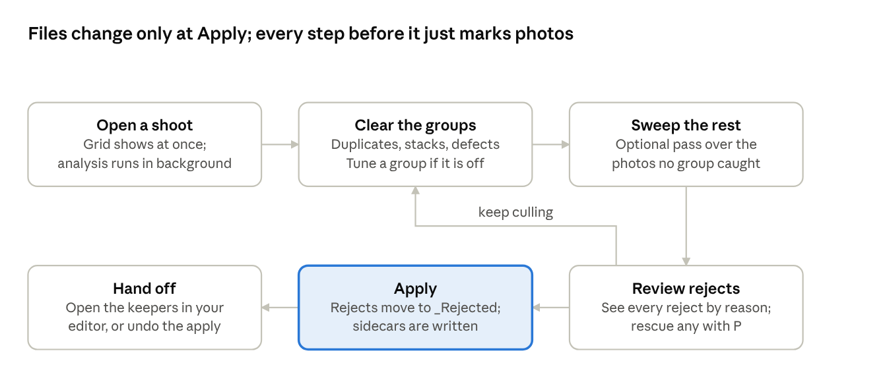

# Culla — User Flows

Last updated: 2026-11-24

A session has four stages: open a shoot, clear the groups Culla found, sweep what is left, then confirm and apply. This doc walks each journey step by step. Screens, keys and settings are defined in [Design](design.md); the build order is in the [Implementation Plan](implementation-plan.md).

## At a glance

Everything up to Review Rejects only marks photos, and the loop back means culling can continue after seeing the summary. Apply is the one step that changes files, and it can be undone.

## Flow 1 — First launch and opening a shoot

Goal: from launch to a usable grid in seconds, with no setup.

1. Launch shows the welcome window: a drop target, an Open Folder button and recent sessions.
2. Drop a folder or memory card, or press ⌘O. macOS asks for access to that folder once.
3. The grid fills from the previews embedded in each file. A RAW+JPEG pair appears as one tile.
4. Analysis starts in the background. The toolbar shows progress and time left, and sidebar counts rise as results arrive.
5. Culling by hand works straight away; nothing is blocked while analysis runs.
6. When analysis ends, a banner sums it up, for example "1,240 photos · 86 stacks · 41 likely rejects", with a Start Reviewing button.
7. Start Reviewing opens the first group that has photos in it.

## Flow 2 — Culling a stack of similar photos

Goal: keep the best one or two frames of a burst. One key when Culla's pick is right, four or fewer when it is not.

1. Select Similar Stacks. Stack review opens on the first undecided stack.
2. Culla shows every frame, stars its best pick, and badges the others with what is wrong (eyes closed, softer).
3. **Pick is right:** press Return. The pick is kept, the rest are rejected, and the next stack opens.
4. **Pick is wrong:** step through frames with ← and →. The face strip shows every face at 100% across all frames.
5. Press P on each frame worth keeping; more than one is fine.
6. Press Return. Unmarked frames in the stack are rejected and the next stack opens.
7. **A frame does not belong:** ⇧G splits it out of the stack and returns it to Unreviewed.
8. **Not sure yet:** ↓ skips to the next stack and leaves this one undecided.

After the last stack, Culla offers the next group in the sidebar.

## Flow 3 — Clearing a defect group

Goal: confirm or dismiss each flagged photo with one key. The steps are the same for Eyes Closed, Blurry, Exposure and Other Issues.

1. Select the group. The loupe opens on the first flagged photo, already zoomed to the evidence: the closed eyes, or the softest part of the subject.
2. The badge names the flag and its tier, Certain or Likely.
3. Press X to reject, or P to keep a false alarm or an intentional effect. The next flagged photo appears.
4. **Optional bulk step:** ⇧X rejects every remaining Certain photo in this group, after showing how many.
5. Photos already decided in a stack do not appear again.

If a group is full of false alarms, tune it instead of dismissing them one by one (Flow 6).

## Flow 4 — Removing duplicates

Goal: keep one copy of each photo, with exact copies handled in a single step.

1. Select Duplicates. Each set shows its copies side by side with file name, folder, size and format.
2. Culla pre-picks the copy to keep: highest resolution first, then RAW over JPEG, then the original file name over a "copy" name.
3. Press Return to accept, or press P on a different copy and then Return.
4. **Exact copies:** Accept All Exact Duplicates clears every byte-identical set at once. The files are identical, so nothing can be lost.
5. **Near-duplicates** are never bulk-accepted; each set is reviewed on its own.

## Flow 5 — Sweeping the photos no group caught

Goal: a quick manual pass over what is left. This flow is optional, because unreviewed photos count as kept.

1. Select Unreviewed. The loupe opens on the first undecided photo, in capture order, with the filmstrip below.
2. Press P or X; the next photo appears. → skips without deciding.
3. Press Z to check focus on any photo before deciding.
4. The status bar shows how many are left. Stop at any point and go to Review and Apply.

## Flow 6 — Tuning detection mid-session

Goal: fix a group that catches too much or too little, without leaving it and without re-analysing.

1. Click the slider icon in the group's header. A popover shows that group's main controls.
2. Drag a slider. A live count shows the effect, for example "Eyes closed: 41 → 28 photos".
3. The group refills as you drag. Scores are already stored, so nothing is re-analysed.
4. Photos you have already decided keep their decision. Only undecided photos enter or leave the group.
5. The change lasts for this session. Save as Default keeps it for future shoots.

The full set of parameters is in Settings (⌘,); the popover holds only the two or three that matter for the group in view.

## Flow 7 — Reviewing and applying decisions

Goal: one last look at everything about to be rejected, then a single confirmed change on disk.

1. Press ⌘Return, or click Review and Apply in the toolbar.
2. The screen shows the rejects grouped by reason, with counts of kept, rejected and unreviewed photos and the disk space the rejects use.
3. Scan the rejects. Press P on any photo to rescue it.
4. Check what will happen to rejects (default: move to `_Rejected`) and to unreviewed photos (default: keep).
5. Click Apply. Rejects move, and XMP sidecars are written for kept and rejected photos.
6. A banner confirms, for example "412 photos moved to _Rejected", with Undo.
7. Choose a next step: Reveal Keepers in Finder, Open Keepers In an editor, or Done.

## Flow 8 — Changing your mind

Goal: every step can be taken back, before and after applying.

- **While culling.** ⌘Z steps back through every decision in the session, bulk actions included. ⇧⌘Z redoes.
- **Before applying.** Open Rejected in the sidebar, or the Review and Apply screen, and press P on any photo to rescue it.
- **After applying.** Undo Apply moves the files back and reverts the sidecars. It stays available in the session until you empty `_Rejected` or the Trash yourself.
- **Coming back later.** Closing the window saves the session. Opening the same folder restores every decision and your place.
- **New files since last time.** They are analysed on reopening and marked New, so a second card from the same shoot joins the session.

## Flow 9 — Learning about a new version

Goal: know when a newer Culla exists, without being interrupted while culling.

1. **Automatic.** At most once a day, when Culla opens or comes to the front, it asks `cullaapp.com` which version is the newest. Nothing about you or your photos is sent.
2. If a newer version exists, the welcome window shows one line: "Culla 1.1 is available." Nothing appears while a shoot is open.
3. Download opens the site in your browser and fetches the disk image; drag the new Culla over the old one in Applications. Release Notes shows what changed. Skip This Version hides the line until the version after it.
4. **By hand.** Culla ▸ Check for Updates… asks at once and always answers, also when the version was skipped or the check failed.
5. **Off.** Settings ▸ General ▸ Check for updates automatically. With it off, Culla goes online only when you choose Check for Updates.

A copy of Culla from the Mac App Store has none of this: the App Store updates it, and it never goes online.

## Edge cases

| Situation | What Culla does |
| --- | --- |
| Card or drive disconnects mid-session | Pauses analysis, dims the tiles, keeps every decision, and resumes when the volume returns |
| A file cannot be read | Shows a warning tile, leaves it out of every group, and never moves it |
| Files are moved or renamed outside Culla | Rescans when the window regains focus; decisions follow files it can match and drop for files that are gone |
| The folder is read-only (a locked card) | Culling works; Apply offers Copy Keepers To another folder instead of moving rejects |
| The shoot has no faces | Eyes Closed stays empty and is skipped by Start Reviewing |
| A very large shoot (10,000 photos or more) | The grid is usable at once; analysis does the visible photos and the open group first |
| RAW+JPEG pair | One tile; a decision applies to both files |
| A sidecar already exists | Only the rating and keep or reject fields are updated; everything else in it is preserved |
| Apply fails part-way (disk full, permission lost) | Stops, reports what moved, and offers Undo for that part |
| Videos in the folder | Skipped in the first version, fully ignored |
| No internet when an update check is due | Nothing is shown; Culla asks again a day later. A check made by hand says it could not be made |
| The newer version needs a newer macOS | An automatic check stays silent; a check made by hand says which macOS it needs |

## Confirmed decisions

These were open questions; all were confirmed in review on 2026-11-09.

- Unreviewed photos count as kept on Apply.
- Memory cards are read in place.
- After the last stack, Culla offers the next group.
- One confirmation is enough for ⇧X, the bulk reject of Certain photos.
- Videos are skipped in the first version and fully ignored.
- Near-duplicates are always reviewed set by set.
